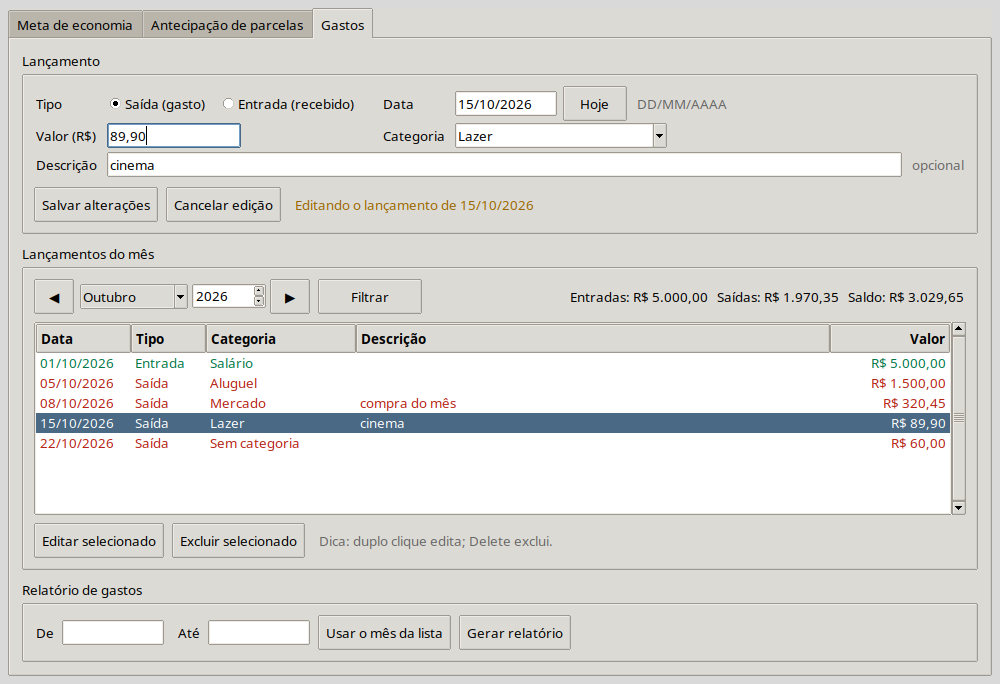

# Finanças

Software desktop **offline** para tirar do caderno os cálculos financeiros do dia a dia:

- **Meta de economia** (cofrinho): em quantos meses atinjo a meta, ou quanto guardar por mês.
- **Antecipação de parcelas**: quanto economizo pagando agora as últimas parcelas de um financiamento.
- **Lançamento de gastos**: entradas e saídas, com edição, exclusão, filtro por mês e relatório por período.

Todo cálculo gera um **relatório em Markdown** (dados informados, fórmula, passo a passo e resultado) que pode ser salvo e aberto no Obsidian. O programa **não pensa por você**: você informa os dados, ele mostra a conta inteira.



> Status: MVP em validação. Veja como foi construído em [`docs/`](docs/).

## Requisitos

- Ubuntu (ou outro Linux) com **Python 3.12+**.
- Pacotes do sistema para o ambiente virtual e a interface gráfica:

  ```bash
  sudo apt install python3.12-venv python3-tk
  ```

## Instalação

```bash
git clone https://github.com/MuriloSRuas/mvp01-app-financeiro.git
cd mvp01-app-financeiro
python3 -m venv .venv
source .venv/bin/activate
pip install -e ".[dev]"
```

## Uso

```bash
source .venv/bin/activate
python -m financas
```

A janela tem três abas:

| Aba | Como usar |
|---|---|
| **Meta de economia** | Escolha a pergunta ("em quantos meses" ou "quanto guardar por mês"), preencha os campos e clique em **Calcular**. A rentabilidade é opcional (vazio = 0%). |
| **Antecipação de parcelas** | Informe o valor da parcela, os juros do contrato (% ao mês) e quantas parcelas faltam além da atual. Depois, quantas quer antecipar **ou** quanto tem disponível. |
| **Gastos** | Escolha entrada ou saída, data (o botão **Hoje** preenche a data de hoje), valor e categoria (escolha uma existente ou digite uma nova). A lista mostra um mês por vez (◀ ▶ trocam o mês). Duplo clique edita; **Delete** exclui (com confirmação). Para o relatório, informe o período (ou clique em **Usar o mês da lista**) e em **Gerar relatório**. |

Valores no formato brasileiro: `1.234,56` ou `1234,56`. Datas como `31/10/2026`.

Em qualquer relatório, **Salvar relatório (.md)** grava o arquivo na pasta que você escolher (por exemplo, o seu cofre do Obsidian).

### Onde ficam os seus dados

Os lançamentos de gastos ficam **só no seu computador**, num arquivo SQLite:

- Linux: `~/.local/share/financas/financas.db`
- Windows: `%APPDATA%\financas\financas.db`

Para fazer backup, copie esse arquivo. Nada é enviado pela internet.

## Testes

```bash
pytest                                                   # todos os testes
pytest --cov=financas.core --cov-report=term-missing     # cobertura do núcleo
```

## Documentação

- [`docs/arquitetura.md`](docs/arquitetura.md): como o código está organizado.
- `docs/fase-0.md` a `docs/fase-5.md`: o que foi feito em cada fase, com decisões e termos técnicos explicados.
- [`docs/exemplos/`](docs/exemplos/): relatórios gerados pelo programa.
- [`docs/ideias-futuras.md`](docs/ideias-futuras.md): ideias anotadas para depois do MVP.

## Licença

MIT. Veja [`LICENSE`](LICENSE).
