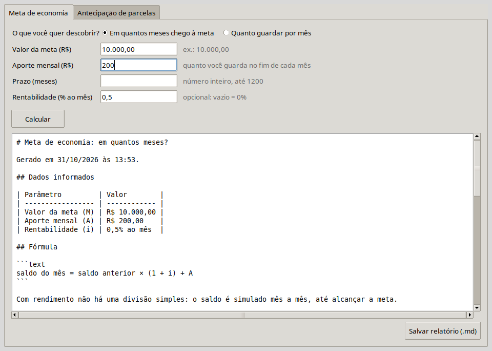
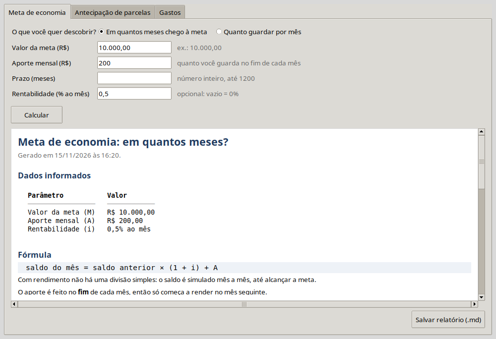
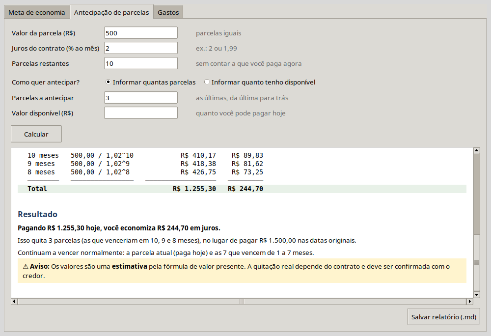
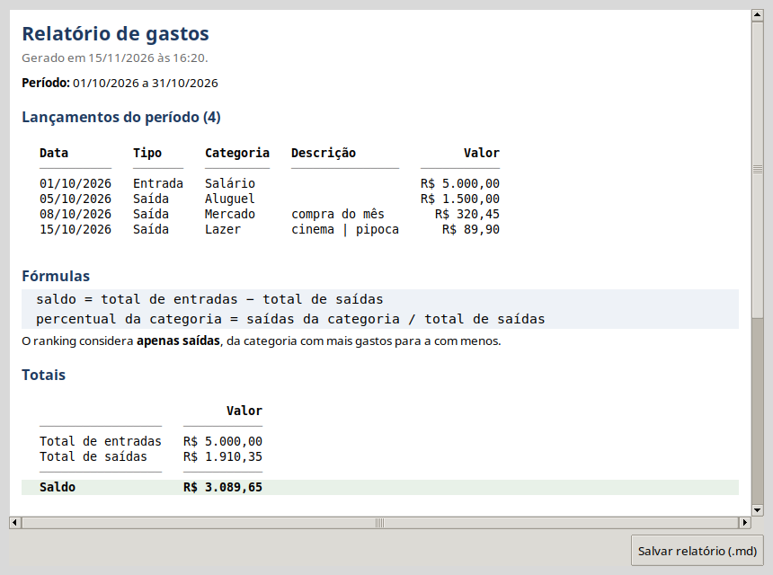

# Ajuste: cálculos formatados na própria tela

Ajuste feito durante a validação do MVP, depois da Fase 5.

## O problema

Até a Fase 5, a área de resultado das calculadoras (e a janela do relatório de gastos) mostrava o **texto Markdown cru**: o mesmo texto que ia para o arquivo `.md`. Na tela apareciam os símbolos do formato (`#` nos títulos, `|` e `---` nas tabelas, `**` no negrito, ```` ``` ```` em volta das fórmulas). A conta estava lá, mas parecia que o programa "gerava um arquivo" em vez de mostrar o cálculo.

| Antes (Fase 3) | Depois |
|---|---|
|  |  |

## O que mudou para quem usa

- O resultado aparece **formatado na tela**: título maior, seções destacadas, fórmulas num fundo cinza, tabelas com colunas alinhadas (valores em R$ à direita), a linha de total ou de saldo final em negrito e o aviso de estimativa num quadro amarelo.
- Nenhum símbolo de Markdown aparece na tela. Uma `|` digitada numa descrição aparece como `|`, sem a barra invertida de escape.
- As **contas e os textos são os mesmos**: dados informados, fórmula, passo a passo, resultado e aviso, na mesma ordem.
- **Salvar relatório (.md)** continua existindo, mas é opcional: o Markdown só é gerado no momento em que você clica no botão. O arquivo salvo é **idêntico** ao das versões anteriores (conferido byte a byte), então os relatórios já guardados no Obsidian continuam compatíveis.





## Como funciona por dentro

Antes, `reports/markdown.py` montava **um texto só**, que servia tanto para a tela quanto para o arquivo. Para a tela poder ter outra aparência, o relatório passou a ser montado como uma **estrutura** (uma lista de blocos), e cada destino desenha essa estrutura do seu jeito:

```
core/  ──►  reports/relatorios.py  ──►  Documento (blocos)
                                            │
                     ┌──────────────────────┴──────────────────────┐
                     ▼                                             ▼
          ui/visualizacao.py                            reports/markdown.py
          desenha na tela, formatado                    converte em Markdown
          (sempre, ao clicar Calcular)                  (só ao clicar Salvar)
```

| Arquivo | O que faz |
|---|---|
| `src/financas/reports/documento.py` | **Novo.** Define os blocos de um relatório (`Secao`, `Paragrafo`, `Formula`, `Tabela`, `Passos`, `Aviso`) e os trechos de texto com estilo (normal, negrito, itálico, código). Não sabe nada de tela nem de Markdown. |
| `src/financas/reports/relatorios.py` | **Novo.** O conteúdo dos relatórios, que antes ficava em `markdown.py`: `relatorio_meses`, `relatorio_aporte`, `relatorio_antecipacao`, `relatorio_gastos`. Agora devolvem um `Documento`. |
| `src/financas/reports/markdown.py` | **Reescrito.** Só tem `para_markdown(documento)`: converte os blocos em Markdown para o arquivo. |
| `src/financas/ui/visualizacao.py` | **Novo.** Desenha o `Documento` na caixa de texto (`tk.Text`) usando tags de estilo. |
| `src/financas/ui/componentes.py` | O `PainelRelatorio` recebe um `Documento`, desenha com `visualizacao.py` e, ao salvar, chama `para_markdown`. |
| `src/financas/ui/aba_*.py` | Passam a importar os relatórios de `reports/relatorios.py`. |

A separação de camadas continua a mesma: `reports/` não importa `tkinter`, e a interface continua sem fazer nenhuma conta.

## Como foi verificado

- **199 testes** (eram 193), com **100%** de cobertura em `core/`, `reports/` e `storage/`.
- Os testes de Markdown existentes passaram sem mudança de conteúdo: só passaram a chamar `para_markdown(relatorios.relatorio_...(...))`.
- Antes da mudança, os relatórios em Markdown de 9 casos foram salvos; depois, foram gerados de novo e comparados: **idênticos**.
- Testes novos garantem que o relatório da tela não contém `**`, `##`, ```` ``` ````, `\|` nem `> [!`, que o texto digitado aparece sem escape e que a linha de saldo final é a destacada.
- O programa foi aberto de verdade, com um banco temporário, preenchendo as três abas; as capturas desta página saíram dessa execução.

## Decisões tomadas

| Decisão | Por quê | Alternativa descartada |
|---|---|---|
| Relatório como **estrutura de blocos**, desenhada de dois jeitos | A tela e o arquivo mostram exatamente as mesmas contas, sem duplicar a lógica dos relatórios. | Interpretar o Markdown para desenhar na tela (frágil, e o Markdown continuaria sendo a "fonte"); escrever os relatórios duas vezes. |
| **Manter** o botão Salvar (.md) | O RF06 e o uso com o Obsidian continuam valendo; agora é só uma opção de exportação. | Remover a exportação. |
| Tabelas em **fonte de largura fixa**, sem quebra de linha | É o jeito simples de alinhar colunas no `tk.Text`. Tabelas largas usam a barra de rolagem horizontal; os parágrafos quebram linha normalmente. | Um `Treeview` por tabela (pesado, e não rola junto com o texto). |
| Colunas só com números, R$ ou % ficam **à direita** | Os valores ficam alinhados pela vírgula, como numa planilha ou no caderno. | Tudo à esquerda. |

## Termos técnicos

- **Tag (`tk.Text`)**: estilo com nome (fonte, cor, margem, fundo) aplicado a trechos de texto, parecido com uma classe CSS. Exemplo: `area.tag_configure("formula", background="#eef2f7")` e depois `area.insert("end", texto, "formula")`.
- **`dataclass(frozen=True)`**: classe simples para guardar dados que não podem ser alterados depois de criados. Os blocos do relatório são assim.
- **`match` / `case`**: escolhe o que fazer de acordo com o tipo do bloco (seção, tabela...), como um `switch` mais poderoso.
