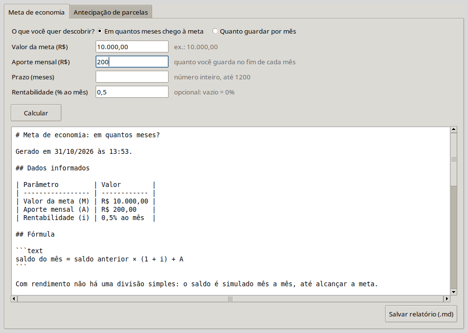
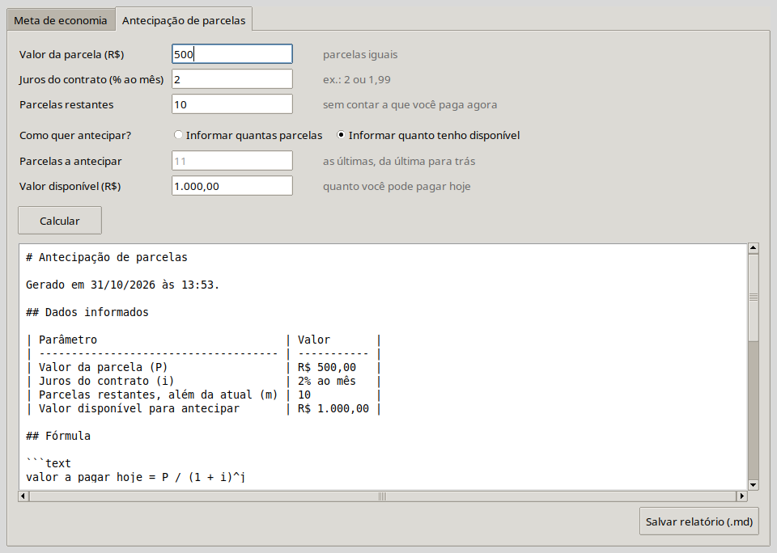

# Fase 3: Interface das calculadoras

## O que foi feito

O programa agora tem **janela**. `python -m financas` abre o Finanças com duas abas:

- **Meta de economia**: escolha a pergunta ("em quantos meses" ou "quanto guardar por mês"), preencha os campos e clique em **Calcular** (ou tecle Enter).
- **Antecipação de parcelas**: informe parcela, juros e parcelas restantes, depois a quantidade a antecipar **ou** o valor disponível.

O relatório da Fase 2 aparece logo abaixo, em fonte monoespaçada. O botão **Salvar relatório (.md)** abre a janela do sistema para escolher pasta e nome (o nome já vem sugerido, ex.: `meta-economia-2026-10-31-1405.md`). Isso completa o RF06 para as calculadoras.

Erros de digitação viram uma mensagem clara ("Valor da meta: '10000.50' não é um número válido. Use vírgula para os centavos...") e o cursor vai para o campo com problema. O programa nunca fecha por causa de um erro.





## Tkinter para quem vem da web

Se você já fez páginas com HTML e PHP, quase tudo tem um equivalente:

| Web | Tkinter | Neste projeto |
|---|---|---|
| A página (`<html>`) | A **janela raiz**, `tk.Tk()` | `criar_janela()` em `ui/app.py` |
| Elementos (`<input>`, `<button>`, `<label>`) | **Widgets**: `ttk.Entry`, `ttk.Button`, `ttk.Label` | campos criados por `criar_campo()` |
| `<div>` que agrupa elementos | **`ttk.Frame`** | `self.formulario`, `PainelRelatorio` |
| Abas feitas com JS/CSS | **`ttk.Notebook`** | as duas abas em `app.py` |
| `<textarea>` | **`tk.Text`** | a área do relatório |
| `<input type="radio">` | **`ttk.Radiobutton`** ligado a uma `StringVar` | "Em quantos meses" / "Quanto guardar" |
| CSS (`display: grid`, `flex`) | **Gerenciadores de geometria**: `grid()` (linhas e colunas) e `pack()` (empilhar) | `grid` no formulário, `pack` no resto |
| `onclick="..."` / `addEventListener` | **`command=`** no botão, ou **`bind("<Evento>", funcao)`** | `command=self.calcular`; `bind("<Return>", ...)` para o Enter |
| `alert()` | **`messagebox.showerror()` / `showinfo()`** | mensagens de erro e "Relatório salvo" |
| `<input type="file">` | **`filedialog.asksaveasfilename()`** | botão Salvar |
| CSS de tema | **`ttk.Style`** | tema `clam` no Linux |

### A grande diferença: não existe requisição

Na web, cada clique vira uma requisição: o navegador chama o servidor, o PHP roda do começo ao fim e devolve uma página nova.

No desktop **o programa fica rodando o tempo todo**. A última linha, `janela.mainloop()`, é um laço infinito do Tkinter que espera eventos (clique, tecla, redimensionar) e chama a função ligada a cada um. Quando você clica em Calcular:

```
clique ─► mainloop percebe ─► chama AbaCalculo.calcular()
              │
              ├─ gerar_relatorio(): lê os campos ─► core calcula ─► reports monta o texto
              │
              └─ painel.mostrar(texto): troca o conteúdo da área de texto
         ◄─ volta para o mainloop, esperando o próximo evento
```

Os valores ficam **na memória**, nos próprios widgets e atributos (`self.campo_meta`, `self._texto_atual`). Não precisa de sessão, cookie nem banco para lembrar o que está na tela.

Consequência: uma função ligada a um evento precisa terminar rápido. Enquanto ela roda, a janela não redesenha (parece "travada"). As nossas contas levam milissegundos, então isso não é problema.

### Herança: a aba "é um" Frame

```python
class AbaMeta(AbaCalculo):        # AbaCalculo herda de ttk.Frame
    def gerar_relatorio(self, momento): ...
```

`AbaCalculo` (em `componentes.py`) monta o esqueleto comum: formulário em cima, botão Calcular, painel do relatório embaixo. Ela também trata os erros. Cada aba concreta só preenche o formulário e diz **como gerar o relatório**. É o mesmo raciocínio de um *controller* base em um framework web.

## Mapa dos arquivos

| Arquivo | O que faz | Conversa com |
|---|---|---|
| `src/financas/__main__.py` | Abre a janela. Se o Tkinter não estiver instalado, mostra como instalar em vez de um erro técnico. | `ui/app.py` |
| `src/financas/ui/app.py` | Cria a janela, o tema e as abas; liga o `mainloop`. Tem a "rede de proteção": um bug inesperado vira mensagem na tela e o detalhe técnico vai para o terminal. | `aba_meta.py`, `aba_antecipacao.py` |
| `src/financas/ui/componentes.py` | Peças comuns: `criar_campo` (rótulo + caixa + dica), `ler_campo` (lê e, se der erro, foca o campo), `PainelRelatorio` (texto + Salvar) e `AbaCalculo` (esqueleto da aba). | `core/dinheiro.py` (`ErroDeValidacao`), `reports/arquivo.py` |
| `src/financas/ui/aba_meta.py` | Formulário do RF01/RF02. Habilita "Aporte" ou "Prazo" conforme a pergunta escolhida. | `core/meta_economia.py`, `reports/markdown.py` |
| `src/financas/ui/aba_antecipacao.py` | Formulário do RF03/RF04. Habilita "Parcelas a antecipar" ou "Valor disponível". | `core/antecipacao.py`, `reports/markdown.py` |
| `src/financas/reports/arquivo.py` | `nome_arquivo` (nome sugerido com data) e `salvar_relatorio` (grava em UTF-8, acrescenta `.md` se faltar). | chamado pelo `PainelRelatorio` |
| `src/financas/reports/markdown.py` | Ganhou alinhamento das colunas das tabelas (veja Decisões). | — |
| `tests/test_arquivo.py` | Testa nome sugerido, UTF-8, extensão `.md` e quebra de linha, usando uma pasta temporária. | `reports/arquivo.py` |
| `docs/imagens/` | Capturas de tela desta fase. | — |

## Como rodar

```bash
source .venv/bin/activate
python -m financas      # abre a janela
pytest                  # 129 testes
```

Roteiro rápido para testar à mão:

1. Aba **Meta**: meta `10.000,00`, aporte `200`, rentabilidade `0,5` → Calcular → "45 meses".
2. Troque para "Quanto guardar por mês", prazo `45` → "R$ 198,72 por mês".
3. Digite `10000.50` na meta → mensagem pedindo vírgula, cursor no campo.
4. Aba **Antecipação**: parcela `500`, juros `2`, restantes `10`, "quanto tenho disponível" = `1.000,00` → "Pagando R$ 828,55 hoje...".
5. **Salvar relatório (.md)** → escolha a pasta do seu cofre (*vault*) do Obsidian e abra a nota lá.

## Como foi verificado

A interface não tem testes automatizados (o plano dispensa na seção 8, e por isso toda a lógica fica fora dela). Para conferir, usei um script descartável, fora do repositório, que abriu a janela de verdade, preencheu os campos, clicou em Calcular e substituiu as caixas de diálogo por versões simuladas. Ele conferiu:

- os resultados das duas abas nos dois modos;
- 6 mensagens de erro diferentes (formato inválido, campo vazio, prazo não inteiro, meta inalcançável, quantidade acima das restantes);
- o foco no campo com erro;
- o botão Salvar desabilitado antes do primeiro cálculo, e o arquivo gravado depois;
- um erro inesperado simulado: mensagem na tela e a janela continua aberta.

As capturas acima são dessa execução.

## Decisões tomadas

| Decisão | Por quê | Alternativa descartada |
|---|---|---|
| Botões de opção (*radio*) para escolher a pergunta; o campo que não se aplica fica **desabilitado** (cinza) | Fica claro qual campo é usado. O usuário não preenche algo que seria ignorado. | Duas abas por calculadora; esconder os campos (a tela "pularia"). |
| Rentabilidade vazia = 0% (só na meta) | O RF01 diz que a taxa é opcional, com padrão 0%. O campo **não** vem preenchido com "0" (princípio "nada preenchido automaticamente"); a dica ao lado explica. | Preencher "0" no campo. |
| Juros da antecipação é **obrigatório** | Sem a taxa do contrato não há o que calcular. Para taxa zero, digite 0. | Vazio = 0%. |
| Erro mostra **uma mensagem por vez** e foca o campo | Simples e direto: corrige, clica de novo. | Listar todos os erros de uma vez (mais código para pouco ganho). |
| `AbaCalculo` e `PainelRelatorio` em `ui/componentes.py` | As duas abas tinham o mesmo esqueleto; sem isso seriam ~60 linhas repetidas. | Repetir o código em cada aba, seguindo a estrutura de pastas à risca. |
| Gravação do arquivo em `reports/arquivo.py`, separada da janela | Assim pode ser testada (está em `tests/test_arquivo.py`); a janela só pergunta onde salvar. | Gravar direto no botão (sem teste). |
| Nome sugerido `tipo-AAAA-MM-DD-HHMM.md` | Fica em ordem cronológica no Obsidian. Sem espaços nem acentos, que às vezes dão problema em links. | "Relatório 31-10-2026.md". |
| Pasta inicial: sua pasta pessoal; depois, a última usada (enquanto o programa estiver aberto) | Normalmente se salva sempre no mesmo cofre do Obsidian. | Guardar a pasta em configuração (é histórico/preferência salva, fora do escopo). |
| **Tabelas alinhadas** com espaços (`markdown.py`) | Na tela o relatório é texto puro, e tabelas desalinhadas ficavam difíceis de ler. Espaços extras continuam sendo Markdown válido, e o Obsidian exibe igual. Os testes conferem que toda linha da tabela tem a mesma largura. | Mostrar desalinhado; renderizar o Markdown na tela (exigiria outra biblioteca). |
| Área de texto **sem quebra de linha** (barra de rolagem horizontal) | Quebrar a linha estragaria as tabelas. | Quebra por palavra. |
| Tema `clam` no Linux, tema nativo no Windows | O tema padrão do Tk no Linux tem aparência antiga. | — |
| Bug inesperado → mensagem + detalhe no terminal | Requisito: o programa nunca fecha e não mostra stack trace ao usuário, mas o detalhe precisa existir para corrigir o bug. | Esconder o erro por completo. |

## Termos técnicos

- **Widget**: qualquer componente visual (botão, caixa de texto, rótulo, aba). Equivale a um elemento HTML.
- **`ttk`**: versão "temática" dos widgets do Tkinter, com aparência mais moderna. Usamos `ttk` sempre que existe a versão (o `tk.Text` não tem).
- **`mainloop()` / laço de eventos**: o laço que mantém a janela viva, esperando e despachando eventos. O programa termina quando a janela é fechada.
- **Evento**: algo que acontece na interface (clique, tecla, foco). `bind("<Return>", funcao)` liga a tecla Enter a uma função.
- **Callback**: a função que você entrega para ser chamada depois, quando o evento acontecer (`command=self.calcular`, sem parênteses: você entrega a função, não o resultado dela).
- **`StringVar`**: uma variável do Tkinter que fica ligada a widgets. Os botões de opção escrevem nela o valor escolhido ("meses" ou "aporte").
- **`grid` / `pack`**: formas de posicionar widgets. `grid` usa linhas e colunas (como uma tabela/CSS grid); `pack` empilha um após o outro (como flexbox numa direção).
- **Herança**: uma classe que reaproveita outra (`class AbaMeta(AbaCalculo)`) e só muda o que é diferente.
- **Diálogo modal**: janela (mensagem ou "Salvar como") que bloqueia a janela principal até ser fechada.
- **Mock**: um "dublê" de uma função, usado em testes para simular, por exemplo, o clique em "Salvar" sem abrir a caixa de diálogo de verdade.
