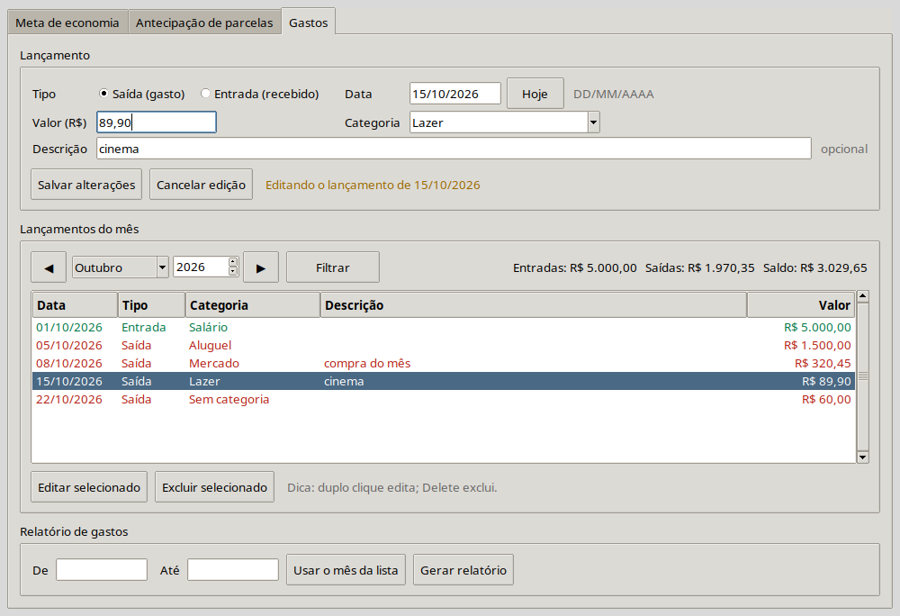
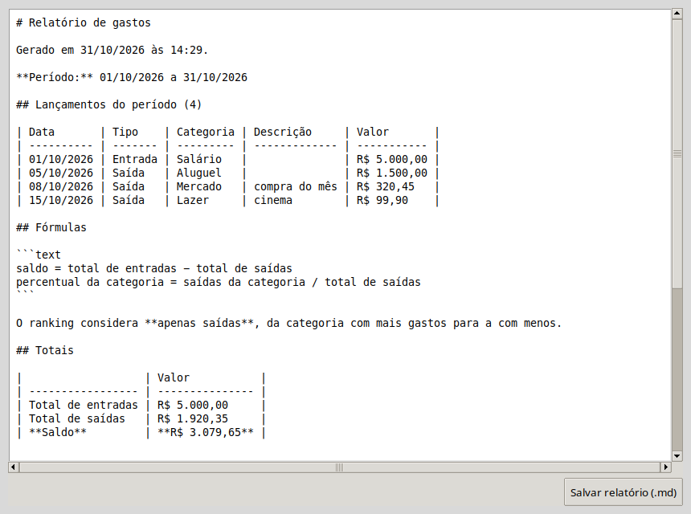

# Fase 5: Interface de gastos e acabamento

## O que foi feito

1. A aba **Gastos** (RF07 a RF11) na janela.
2. A **revisão geral**: README reescrito com instruções de uso, arquitetura atualizada e cobertura conferida.

Com isso, **todos os requisitos do MVP (RF01 a RF11) estão funcionando**, e começa o período de validação de 14 dias (seção 1 do plano).



## A aba Gastos

Três blocos, de cima para baixo:

| Bloco | O que dá para fazer | Requisito |
|---|---|---|
| **Lançamento** | Escolher **Saída** ou **Entrada**, data (botão **Hoje** preenche a de hoje), valor, categoria e descrição opcional. **Adicionar** grava. Ao editar, o botão vira **Salvar alterações** e aparece **Cancelar edição**. | RF07, RF08 |
| | A **categoria** é uma caixa com as categorias já usadas; para criar uma nova, é só digitar. | RF09 |
| **Lançamentos do mês** | Mês e ano (◀ ▶ trocam o mês), tabela com saídas em vermelho e entradas em verde, e totais do mês (entradas, saídas, saldo). **Duplo clique** ou **Editar selecionado** carrega o lançamento no formulário. **Delete** ou **Excluir selecionado** pede confirmação antes de apagar. | RF08, RF10 |
| **Relatório de gastos** | Período **De / Até** (ou **Usar o mês da lista**) e **Gerar relatório**, que abre uma janela com o relatório e o botão **Salvar relatório (.md)**. | RF11, RF06 |



## Mapa dos arquivos

| Arquivo | O que faz | Conversa com |
|---|---|---|
| `src/financas/ui/aba_gastos.py` | A aba inteira: formulário, lista, filtro, edição, exclusão, relatório. Não faz contas nem SQL. | `core/gastos.py` (validação, resumo), `storage/repositorio.py` (gravar/buscar), `reports/markdown.py` (texto), `ui/componentes.py` (`PainelRelatorio`, mensagens) |
| `src/financas/ui/app.py` | Agora abre o banco, cria a aba Gastos e fecha o banco ao fechar a janela. Se o banco não abrir, mostra o motivo e mantém as calculadoras. | `storage/caminhos.py`, `storage/repositorio.py`, `aba_gastos.py` |
| `README.md` | Reescrito: instalação, uso de cada aba, onde ficam os dados e como fazer backup. | — |
| `docs/arquitetura.md` | Árvore de arquivos completa. | — |
| `docs/imagens/fase-5-*.png` | Capturas desta fase. | — |

### O caminho de um lançamento

```
"Adicionar" ─► salvar_lancamento()
                 ├─ ler_dinheiro / ler_data   (core/dinheiro, core/gastos: texto → valores)
                 ├─ novo_lancamento(...)      (core/gastos: valida e limpa)
                 ├─ repo.adicionar(...)       (storage: grava em centavos)
                 └─ _mostrar_mes(...)         (relê o mês do banco e redesenha a tabela)
```

A tabela é sempre redesenhada **a partir do banco**, nunca editada "à mão". Assim o que aparece na tela é sempre o que está gravado.

## Como rodar

```bash
source .venv/bin/activate
python -m financas      # abre a janela
pytest                  # 193 testes
pytest --cov=financas.core --cov=financas.reports --cov=financas.storage --cov-report=term-missing
```

Roteiro rápido na aba **Gastos**:

1. Saída, **Hoje**, `45,90`, categoria `Mercado`, Enter → aparece na lista em vermelho, totais atualizados.
2. Entrada, mesma data, `3.000`, categoria `Salário` → saldo positivo.
3. Duplo clique no Mercado → mude para `50` → **Salvar alterações**.
4. Selecione e tecle **Delete** → confirme.
5. **Usar o mês da lista** → **Gerar relatório** → **Salvar relatório (.md)** no seu cofre do Obsidian.

## Como foi verificado

- **193 testes automatizados**, com **100%** de cobertura em `core/`, `reports/` e `storage/`. O plano pedia ≥ 90% no `core/`. A pasta `ui/` fica fora da medição de propósito: o plano dispensa testes automatizados da interface, e toda a lógica foi mantida fora dela.
- **Script de tela descartável** (fora do repositório), rodando a janela de verdade com um banco temporário. Ele conferiu:
  - os três erros de lançamento (sem tipo, 31/02, valor zero);
  - o lançamento de 6 itens, com o filtro indo para o mês do lançamento;
  - os totais e a lista de categorias;
  - a edição (formulário carregado e valor alterado);
  - a exclusão cancelada e a confirmada;
  - o relatório do mês, com saldo conferido à mão (5.000 − 1.500 − 320,45 − 99,90 = 3.079,65);
  - o erro de período invertido;
  - os dados que persistem ao reabrir;
  - o banco inacessível, com as calculadoras continuando a funcionar.

## Decisões tomadas

| Decisão | Por quê | Alternativa descartada |
|---|---|---|
| **Tipo e data começam vazios**; o botão **Hoje** preenche a data só quando clicado | Princípio do plano: "nenhum valor é preenchido ou sugerido automaticamente". O botão evita digitar a data todo dia sem decidir por você. | Data de hoje já preenchida; "Saída" já marcada. |
| Depois de **Adicionar**, a **data continua** no campo; tipo, valor, categoria e descrição são limpos | É comum lançar vários gastos do mesmo dia. A data foi digitada por você, não sugerida. O tipo é limpo para não lançar uma entrada como saída por engano. | Limpar tudo; manter tudo. |
| A lista **abre no mês atual** | É só navegação (qual mês ver), não um dado. Sem isso a tela abriria vazia. | Abrir sem mês. |
| Ao salvar, a lista **vai para o mês do lançamento** e o seleciona | Se você lança algo de outro mês, vê na hora que foi gravado. | Ficar no mês atual e o lançamento "sumir". |
| **Combobox editável** para categoria | Atende o RF09 com um campo só: escolher existente ou digitar nova. Evita "Mercado" e "mercado" sem querer. | Botão "nova categoria" separado. |
| Exclusão com confirmação que **descreve o lançamento**, com "Não" como padrão | Fica claro o que será apagado; Enter por reflexo não apaga. | "Tem certeza?" genérico. |
| Relatório de gastos em **janela separada** | A aba já tem três blocos; a janela do relatório pode ficar aberta ao lado da lista. Reaproveita o `PainelRelatorio` das calculadoras. | Área de texto dentro da aba (espremeria a lista). |
| Totais do mês ao lado do filtro | Dá uma visão rápida sem gerar relatório; usa o mesmo `resumir` do core. | Só no relatório. |
| Cores: saída em vermelho, entrada em verde | Leitura rápida da lista. A coluna "Tipo" continua escrita, para não depender só da cor. | Sem cor. |
| Banco que não abre → aviso e **calculadoras continuam** | Um problema nos gastos não deve impedir de usar as calculadoras. | Fechar o programa. |
| Banco fechado ao clicar no X | Encerra a conexão de forma limpa. (Cada gravação já é confirmada na hora, então nada se perde mesmo se o programa for fechado à força.) | — |

## Definição de "pronto" do MVP (seção 9 do plano)

- [x] Todos os requisitos RF01 a RF11 funcionando (RF04 incluído).
- [x] Todos os exemplos da seção 6 passando nos testes; cobertura de `core/` ≥ 90% (está em 100%).
- [x] Roda no Ubuntu com `python -m financas` a partir do `venv`, sem internet.
- [ ] Relatórios exportados abrem corretamente no Obsidian. Os testes garantem Markdown válido (tabelas, blocos, escape de `|`), mas **falta você abrir** os arquivos de `docs/exemplos/` no seu Obsidian e confirmar.
- [x] `README.md` explica instalação e uso; `docs/` está completo.
- [ ] O usuário consegue explicar, com as próprias palavras, o que cada módulo faz. Isso depende de você; os documentos `docs/fase-N.md` e `docs/arquitetura.md` foram escritos para isso.

## Próximo passo: validação (14 dias)

Pelo critério da seção 1 do plano, o MVP está validado se, em 14 dias de uso real, você:

- fizer pelo menos **3 cálculos reais** (meta ou antecipação) sem recorrer ao caderno;
- **lançar seus gastos** no programa durante o período;
- concluir que os relatórios têm tudo de que você precisaria no papel.

A Fase 6 (empacotamento `.deb`/`.exe`) só começa depois disso.

## Termos técnicos

- **`ttk.Treeview`**: widget de tabela (lista com colunas). Cada linha tem um identificador (`iid`); usamos o `id` do lançamento no banco.
- **`ttk.Combobox`**: caixa de texto com lista suspensa. `state="readonly"` (no mês) só deixa escolher; sem isso (na categoria) também deixa digitar.
- **`ttk.LabelFrame`**: moldura com título, para agrupar campos (como `<fieldset>` + `<legend>` no HTML).
- **`tk.Toplevel`**: uma janela extra do mesmo programa (a do relatório de gastos).
- **Tag (Treeview)**: rótulo aplicado a linhas para estilizá-las juntas, como uma classe CSS (`tag_configure("saida", foreground="...")`).
- **`protocol("WM_DELETE_WINDOW", ...)`**: define o que acontece quando o usuário clica no X da janela.
- **Evento virtual `<<ComboboxSelected>>`**: avisado quando uma opção da lista é escolhida; usado para filtrar ao trocar o mês.
